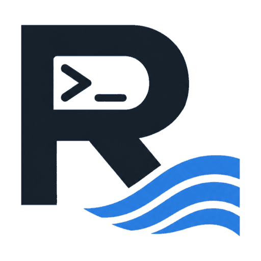

<p align="center"></p>

# Rconsole — free hosting for your bots, websites and workers

> 🌐 **[Documentation website](https://salehin-07.github.io/rconsole-ark/)** ·
> 🆓 **Start here → [FREE_HOSTING.md](FREE_HOSTING.md)** (host on Render's free tier from your phone) ·
> 📦 **Other hosts** → [DEPLOY.md](DEPLOY.md) ·
> 📖 **Every command** → [COMMANDS.md](COMMANDS.md) ·
> ⚙️ **Every setting** → [docs/configuration.md](docs/configuration.md) ·
> 🔒 **Security** → [docs/security.md](docs/security.md) ·
> 🧾 **What's new** → [CHANGELOG.md](CHANGELOG.md) ·
> ⬇️ **Self-host from a release** → [Releases](../../releases)

**Version 2.0.3** · MIT licensed · made by Md Abu Salehin

Rconsole is a Linux console in your browser that you can host for **free**. Put it on one small web service (Render's
free tier is the reference setup) and you get a terminal, your own Linux systems, a process supervisor and a way to
publish what you run, all usable from a phone. It is built for people with no budget who still want to run a Telegram
bot, a scraper, a queue worker or a website. Why it exists and the long feature list: [docs/about.md](docs/about.md).

## What you get

- **A real terminal** (line-mode commands plus `nano`, `vim`, `top`, ...), a file manager and a code editor, laid out for small screens.
- **Your own Linux systems** (Debian, Ubuntu, Kali, Arch, Alpine): per-user, root inside, no host privileges needed. PRoot-based, not true virtual machines. → [docs/vm.md](docs/vm.md)
- **`service`** keeps bots and workers running (autostart, restart on crash, logs); **`expose`** publishes a web server at `/<name>/`. → [docs/hosting-apps.md](docs/hosting-apps.md)
- **Free-tier helpers**: a keep-alive ping, encrypted backups to a private git repo with automatic restore, files kept in your GitHub repo, `sudo reboot`. → [docs/backup.md](docs/backup.md), [docs/repo-storage.md](docs/repo-storage.md)
- **An AI agent** (`sudo agent`) that works inside the console: it knows Rconsole, your host or VM and your folders, and learns new tasks from skills. → [docs/ai-agent.md](docs/ai-agent.md)
- **`rconsole update`**: checksum-verified self-update with automatic rollback. → [docs/upgrading.md](docs/upgrading.md)

Be honest about the limits: free instances have about 512 MB RAM, restart when the provider decides, lose their disk unless
you set up backups or repo storage, and the Linux environments are a compatibility layer, not a hard sandbox (one user id,
separate PID namespaces where the host allows it). Designed for one person or a small team (default cap: 10 accounts).

## Quick start

```bash
uv sync                      # create the environment
uv run python main.py        # http://127.0.0.1:5000
```

Log in as **`ark` / `ark`**, then change the password at once (**Dashboard → Account** or `sudo cpass`), or set
`RCONSOLE_ADMIN_PASSWORD` before the first start. Requires Python **>= 3.14** and [`uv`](https://docs.astral.sh/uv/)
(or `pip install -r requirements.txt`); the Linux systems need Linux (proot is fetched automatically on x86-64).
Production server, Docker, Windows notes and the one-command VPS setup: [docs/quick-start.md](docs/quick-start.md),
[docs/about.md](docs/about.md#requirements) and [DEPLOY.md](DEPLOY.md).

## Documentation

| I want to... | Read |
|---|---|
| Run it in five minutes, or deploy it | [docs/quick-start.md](docs/quick-start.md) · [FREE_HOSTING.md](FREE_HOSTING.md) · [DEPLOY.md](DEPLOY.md) |
| Know why it exists and every feature | [docs/about.md](docs/about.md) · [FEATURES.md](FEATURES.md) |
| Use the console and its commands | [docs/console.md](docs/console.md) · [COMMANDS.md](COMMANDS.md) |
| Work with Linux systems (`vm`) | [docs/vm.md](docs/vm.md) |
| Host a bot, worker or website | [docs/hosting-apps.md](docs/hosting-apps.md) |
| Use the AI agent, providers and skills | [docs/ai-agent.md](docs/ai-agent.md) |
| Back up, restore, keep files in GitHub | [docs/backup.md](docs/backup.md) · [docs/repo-storage.md](docs/repo-storage.md) |
| Change a setting (every environment variable) | [docs/configuration.md](docs/configuration.md) |
| Update or roll back | [docs/upgrading.md](docs/upgrading.md) |
| Understand the design and the security model | [docs/architecture.md](docs/architecture.md) · [docs/security.md](docs/security.md) · [SECURITY.md](SECURITY.md) |
| Fix a problem | [docs/troubleshooting.md](docs/troubleshooting.md) |
| Run the tests (`uv run python -m unittest discover -s tests`) | [docs/testing.md](docs/testing.md) |
| Find a source file | [structure.md](structure.md) |

## License

[MIT](LICENSE) © 2026 Salehin-07 (MD ABU SALEHIN).
