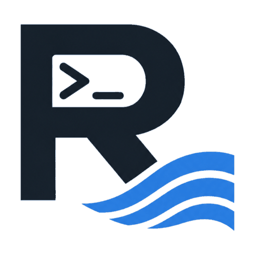

# Rconsole

**Rconsole is a Linux console in your browser that you can host for free.** You put it on one small web service
(Render's free tier is the reference setup) and get a terminal, your own Linux systems, a process supervisor and a way
to publish what you run, all usable from a phone.

<a class="card" href="quick-start.md"><b>Quick start</b>Running locally in five minutes, or on a server.</a>
<a class="card" href="../FREE_HOSTING.md"><b>Free hosting on Render</b>Bots, sites and workers with no budget.</a>
<a class="card" href="../DEPLOY.md"><b>Deploy anywhere</b>Railway, Fly.io, a VPS, Kubernetes, a Raspberry Pi.</a>
<a class="card" href="../COMMANDS.md"><b>Command reference</b>Every command, option and example.</a>
<a class="card" href="configuration.md"><b>Configuration</b>Every environment variable, in one list.</a>
<a class="card" href="security.md"><b>Security model</b>What is isolated and what is not.</a>

## What you get

* **A real terminal** (line-mode commands plus full-screen programs such as `nano`, `vim` and `top`), a file manager
  and a code editor, all in the browser and laid out for small screens.
* **Your own Linux environments** (Debian, Ubuntu, Kali, Alpine): per-user, root inside, no host privileges needed.
  They are PRoot-based environments, not virtual machines (see [the security model](security.md)).
* **`service`**: named commands that Rconsole starts when it starts and restarts when they crash, with logs.
* **`expose`**: publish a web server you run (static or dynamic) at `https://<your-domain>/<name>/`.
* **Free-tier helpers**: a keep-alive ping, encrypted backups to a private git repository, automatic restore on a
  blank instance, and `sudo reboot` to restart in place.
* **`rconsole update`**: checksum-verified self-update with automatic rollback.

## What it is not

Be clear about these before you rely on it:

| It is not... | What is true instead |
|---|---|
| A guarantee of uptime | The keep-alive ping only prevents *inactivity-based* suspension. The provider can still restart, suspend or stop your instance (maintenance, quota or hours used up, policy changes). Expect a few minutes of downtime after a restart. |
| Free on every host | Free means free **on a platform that has a free tier**. Only Render's free plan is a tested reference. Other hosts in the [deploy guide](../DEPLOY.md) may charge for compute, storage or both, and their free offers change. |
| Persistent storage on a free tier | Free instances lose their disk on every restart. Rconsole restores from an encrypted backup, so you can lose everything changed since the last backup (up to 15 minutes by default). See [Backups](backup.md). |
| Uninterrupted services across a redeploy | Processes are stopped when the instance stops. Service *definitions* and their files are restored, and the supervisor starts the services again once their Linux environment is rebuilt. |
| A hard security boundary | Each Linux environment has its own root filesystem, home and, where the host allows it, its own PID namespace. All of them still run under the server's one user id. Give accounts only to people you trust. |
| A public multi-user hosting platform | It is built for one person or a small trusted team (10 accounts by default). |

## Where to read next

1. [Quick start](quick-start.md) to get something running.
2. [Free hosting](../FREE_HOSTING.md) if you have no budget, or [Deploy anywhere](../DEPLOY.md) if you do.
3. [Backups](backup.md) and [Updating](upgrading.md) before you depend on it.
4. [Configuration](configuration.md), the [command reference](../COMMANDS.md) and the [security model](security.md).

Source code and issues: [github.com/Salehin-07/rconsole-ark](https://github.com/Salehin-07/rconsole-ark) ·
MIT licensed.
